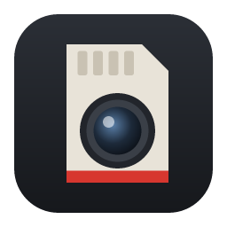
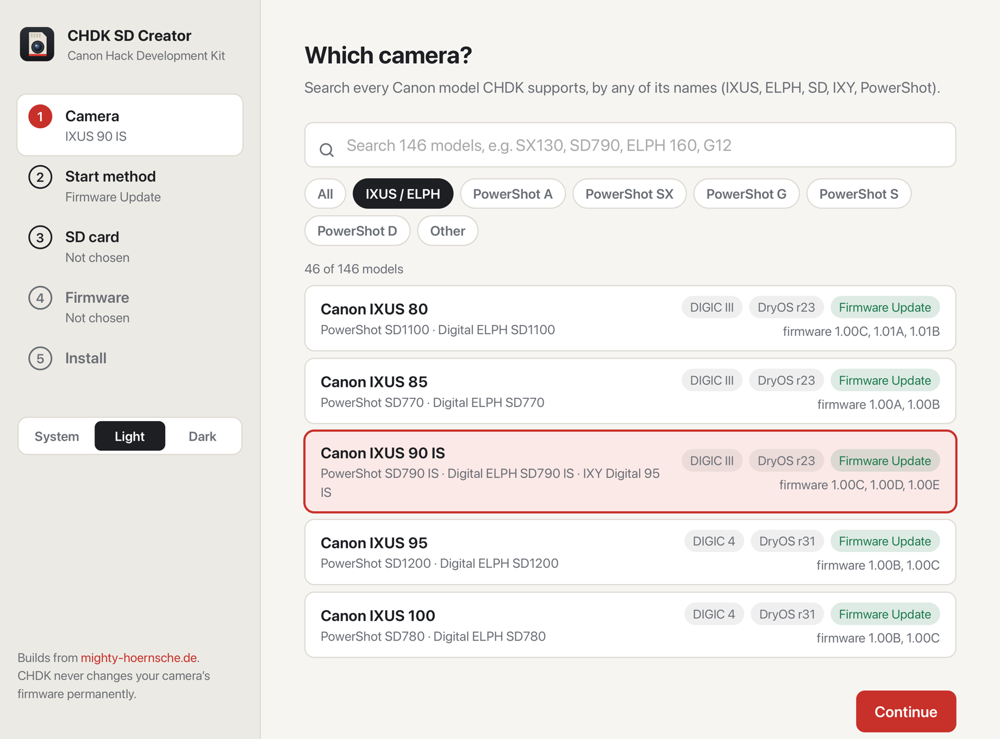
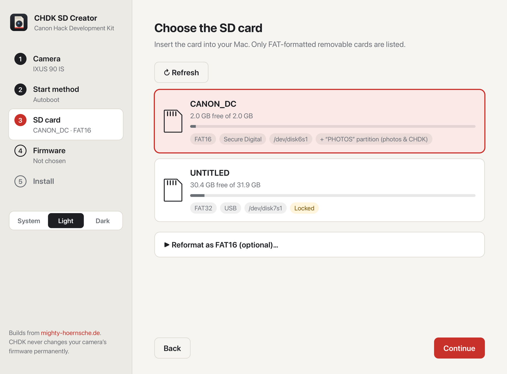
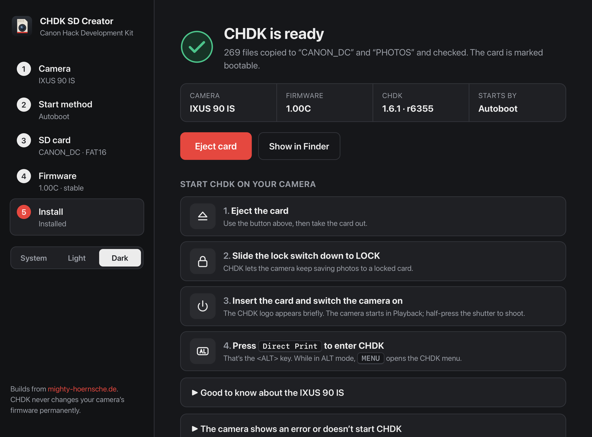

<p align="center">
  
</p>

<h1 align="center">CHDK SD Creator</h1>

<p align="center">
  Put <a href="https://chdk.fandom.com/wiki/CHDK">CHDK</a> on an SD card for your Canon PowerShot or IXUS camera, in a few clicks.
</p>

<p align="center">
  <a href="https://github.com/andrea-campa/chdk-sd-creator/actions/workflows/ci.yml"></a>
  <a href="https://github.com/andrea-campa/chdk-sd-creator/releases/latest"></a>
  
  
  <a href="LICENSE"></a>
</p>

<p align="center">
  
</p>

[CHDK](https://chdk.fandom.com/wiki/CHDK) (Canon Hack Development Kit) adds RAW/DNG, manual exposure, scripting and much more to Canon point-and-shoot cameras. It runs from the SD card and never changes the camera permanently. Setting the card up by hand means finding your exact firmware version, downloading the right build, getting the card format right and sometimes editing its boot sector. **CHDK SD Creator does all of that for you.**

## Features

- **Every CHDK camera:** 146 Canon models, searchable by any of their names (IXUS, ELPH, SD, IXY or PowerShot).
- **The right build, automatically:** pick your firmware version and the app downloads the matching stable or development build from the official CHDK build server.
- **Both start methods:**
  - **Firmware Update:** the card stays unlocked, and you load CHDK from the camera menu.
  - **Autoboot:** CHDK starts by itself whenever the card is locked.
- **Card formats handled for you:**
  - **FAT16 or FAT32:** the app knows which your camera can boot from.
  - **Two-partition cards:** for older models, CHDK is put on both partitions.
  - **Formatting:** it can format the card for you, always asking first.
- **Firmware version helper:** writes the `ver.req` file and tells you which buttons show the full version in the camera.
- **Safe by design:**
  - **Card list:** only FAT-formatted removable cards are offered.
  - **Locked cards:** they're detected, and nothing is written until you unlock them.
  - **Copy check:** every copied file is checked.
- **Native and light:** an 8 MB macOS app with light and dark themes that follow the system.

<table>
  <tr>
    <td></td>
    <td></td>
  </tr>
</table>

## Download

Get the latest `.dmg` from [**Releases**](https://github.com/andrea-campa/chdk-sd-creator/releases/latest), open it and drag **CHDK SD Creator** into Applications.

> [!NOTE]
> The app isn't notarized by Apple yet. The first time you open it, macOS will block it. Go to **System Settings → Privacy & Security** and click **Open Anyway**.

Requires macOS 11 or later, on Apple silicon or Intel.

## How to use

1. **Camera:** search for your model, for example `SX130`, `SD790` or `ELPH 160`.
2. **Start method:** choose between Firmware Update and Autoboot (compared below).
3. **SD card:** insert the card. If it needs a different format for the method you picked, the app offers to format it.
4. **Firmware:** pick your camera's firmware version. If you don't know it, the app explains how to find it.
5. **Install:** the app downloads the build, copies it to the card and, for Autoboot, marks the card bootable. It then shows the exact steps to do on the camera.

| | Firmware Update | Autoboot |
|---|---|---|
| How CHDK starts | Start the camera in Playback → **Menu → Firmware Update → OK** | Starts by itself when the card is **locked** |
| Repeat after power-off | Yes | No |
| Card format | Any FAT | FAT16 on older cameras; FAT32 on DryOS r47+ (2011 and later) |
| Needs Full Disk Access | No | Yes, to write the card's boot sector |
| Supported by | 103 of 146 cameras | All cameras |

> [!TIP]
> Want to use the camera without CHDK? With Autoboot, just unlock the card. With Firmware Update, simply don't load it.

## Supported cameras

All 146 Canon cameras with a build on the [CHDK autobuild server](https://mighty-hoernsche.de/): PowerShot A, SX, G, S and D models, the IXUS / ELPH / SD range, and the PowerShot N and TX1.

The list is generated from CHDK's own data. For each camera it records:
- the firmware versions with a CHDK build;
- whether the camera supports the Firmware Update method;
- whether it can autoboot from FAT32;
- whether it uses two-partition cards.

See [`src-tauri/cameras.toml`](src-tauri/cameras.toml) for the full list.

Only the IXUS 90 IS has been tested in a real camera so far. Reports for other models are very welcome: please [open an issue](https://github.com/andrea-campa/chdk-sd-creator/issues/new/choose).

## How it works

<details>
<summary>Technical details</summary>

- **Builds:**
  - **Source:** downloaded from the CHDK autobuild server (`mighty-hoernsche.de`), which hosts the official stable (1.6.x) and development (1.7.x) branches.
  - **Caching:** downloads are cached, so a version you've already installed stays available offline.
- **Autoboot:**
  - **Boot marker:** Canon firmware loads `DISKBOOT.BIN` at power-on when the card is locked and its volume boot sector carries the `BOOTDISK` signature. It goes at offset `0x40` on FAT12/16 and at `0x1E0` on FAT32.
  - **How the app writes it:** it unmounts the card, patches the 512-byte boot sector and reads it back to confirm.
  - **Permissions:** macOS requires Full Disk Access and an administrator password for this.
- **Two-partition cards:** cameras with `CAM_MULTIPART` boot from the first (FAT16) partition. CHDK then switches the camera to the first FAT32 partition, so the app copies CHDK onto both.
- **Card handling:** done through `diskutil`. Only FAT volumes on removable media are listed, and a disk is only offered for formatting if every partition on it is FAT and it's 256 GB or smaller.

</details>

## Building from source

You need [Rust](https://rustup.rs) (1.77.2 or later), the Tauri CLI and Xcode Command Line Tools.

```bash
cargo install tauri-cli --version "^2" --locked
git clone https://github.com/andrea-campa/chdk-sd-creator.git
cd chdk-sd-creator/src-tauri
cargo tauri dev                    # run in development mode
cargo tauri build --bundles app    # release build in target/release/bundle/macos
```

### Tests

```bash
cd src-tauri
cargo test
```

An opt-in end-to-end test runs the real install flow against a macOS disk image instead of an SD card:

```bash
hdiutil create -size 64m -fs "MS-DOS FAT16" -volname CHDKTEST -layout MBRSPUD /tmp/t.dmg
hdiutil attach /tmp/t.dmg          # note the diskNs1 device
CHDK_TEST_DEVICE=diskNs1 cargo test --test disk_image -- --ignored --nocapture
```

### Updating the camera list

```bash
python3 tools/gen_cameras.py
```

This regenerates `src-tauri/cameras.toml` from the CHDK build server and source. Hand-written details, such as marketing names and notes, go in [`src-tauri/cameras.overrides.toml`](src-tauri/cameras.overrides.toml) and always win.

### Project layout

```
src-tauri/
  src/
    autobuild.rs       finding and downloading CHDK builds
    bootsector.rs      FAT16/FAT32 BOOTDISK signature
    cameras.rs         camera registry (loads cameras.toml)
    disks/macos.rs     card detection, (un)mounting, formatting, ejecting
    install.rs         unpacking and verifying files
    lib.rs             Tauri commands
  cameras.toml         generated camera list
ui/                    HTML, CSS and JavaScript front end (no build step)
tools/gen_cameras.py   camera list generator
```

## Contributing

Bug reports, camera test reports and pull requests are welcome. See [CONTRIBUTING.md](CONTRIBUTING.md).

## Acknowledgements

All the hard work behind CHDK is done by the [CHDK community](https://chdk.setepontos.com/). This app only gets it onto your card. Builds are served by the [CHDK autobuild](https://mighty-hoernsche.de/).

## License

[GPL-3.0-or-later](LICENSE) © 2026 Andrea Campa

You may use, study, share and modify this app freely. If you distribute it, or a modified version, you must do so under the same license and make the full source code available.

CHDK itself is also GPL-licensed. It is downloaded from the CHDK build server at install time and is not part of this repository.

*Not affiliated with or endorsed by Canon Inc. or the CHDK project. Canon, PowerShot, IXUS and ELPH are trademarks of Canon Inc. Use at your own risk.*
